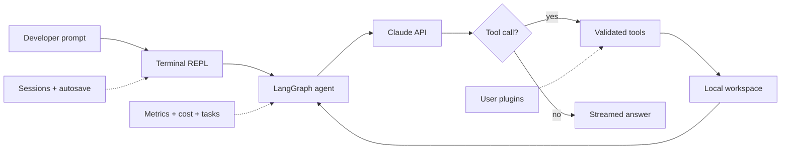

# DevMind

[](https://github.com/PRINCE2-AI/devmind/actions/workflows/ci.yml)
[](https://www.python.org/)
[](https://langchain-ai.github.io/langgraph/)
[](https://docs.anthropic.com/en/api/getting-started)
[](LICENSE)
[](https://github.com/PRINCE2-AI/devmind/stargazers)

**A terminal-native coding agent built with Python, LangGraph, and Claude.**

DevMind can inspect a workspace, search and edit files, run shell commands, stream responses, track API cost, and preserve conversation sessions. It is designed as a readable reference implementation for developers learning how tool-using coding agents fit together.

> [!NOTE]
> DevMind is an independent open-source project inspired by modern terminal coding-agent workflows. It is not affiliated with or endorsed by Anthropic or the Claude Code team.

## See it in action

```text
$ python main.py

+-------------------------------------------------------+
|  DevMind   AI Coding Assistant                        |
+-------------------------------------------------------+

You: find the failing tests and explain the root cause

DevMind: [searches the project] [runs tests] [reads code]
         The failure comes from the session loader. I found the
         inconsistent validation path and can patch it now.
```

## Why DevMind

- **Agentic tool loop:** LangGraph routes between Claude and tools until the task is complete.
- **Workspace-aware tools:** read, write, edit, search, list, and shell operations share path and input validation.
- **Reliable sessions:** named saves, autosave, atomic persistence, and compacted conversation history.
- **Visible operation:** streaming output, structured logs, task state, retry metrics, and per-tool latency.
- **Cost awareness:** token usage and estimated USD cost are recorded for each API call.
- **Offline confidence:** 156 tests cover tools, security guards, persistence, metrics, plugins, and control flow without paid API calls.

## Architecture



The built-in execution loop is intentionally small enough to study:

1. DevMind builds a project-aware system prompt.
2. Claude decides whether it needs a tool.
3. LangGraph executes the requested tool and returns the result.
4. The loop continues until Claude produces a final response.
5. Metrics, task state, cost, and session data are recorded around the loop.

## Quick start

### 1. Clone and install

```bash
git clone https://github.com/PRINCE2-AI/devmind.git
cd devmind
python -m venv .venv
```

Windows PowerShell:

```powershell
.\.venv\Scripts\Activate.ps1
pip install -r requirements.txt
Copy-Item .env.example .env
```

macOS/Linux:

```bash
source .venv/bin/activate
pip install -r requirements.txt
cp .env.example .env
```

> [!IMPORTANT]
> DevMind requires Python 3.11 or newer and an Anthropic API key. Shell execution uses Bash; on Windows, install Git for Windows so DevMind can use Git Bash.

### 2. Configure Claude

Edit `.env` and set your key. Never commit this file.

```env
ANTHROPIC_API_KEY=your-anthropic-api-key
DEVMIND_MODEL=claude-sonnet-4-6
```

### 3. Start DevMind

Run it from the project you want the agent to work on:

```powershell
python C:\path\to\devmind\main.py
```

Or start it inside the DevMind repository:

```powershell
python main.py
```

Try a focused first task:

```text
Map this project, run its tests, and tell me the highest-risk bug you find.
```

## Built-in tools

| Tool | What it does |
| --- | --- |
| `bash_tool` | Runs a Bash command with a timeout and blocked-command checks |
| `file_read_tool` | Reads a validated text file from the current workspace |
| `file_write_tool` | Creates or replaces a file within the workspace |
| `file_edit_tool` | Replaces an exact text block in an existing file |
| `grep_tool` | Searches supported text files while skipping heavy directories |
| `list_files_tool` | Lists workspace files and sizes |

Every built-in tool records duration and success status for `/metrics`.

## Terminal commands

| Command | Purpose |
| --- | --- |
| `/help` | Show the command reference |
| `/cost` | Show token usage and estimated session cost |
| `/metrics` | Show latency, success, retry, and tool statistics |
| `/tasks` | Show task lifecycle history |
| `/history` | Show recent conversation messages |
| `/save <name>` | Save the current conversation |
| `/load <name>` | Load a saved conversation |
| `/sessions` | List saved conversations |
| `/delete <name>` | Delete a saved conversation |
| `/cd <path>` | Change the active workspace |
| `/clear` | Clear conversation history |
| `/exit` | Close DevMind |

## Safety boundaries

DevMind validates paths, blocks known destructive command patterns, rejects privilege-escalation commands, caps input sizes, masks common secret formats in logs, and keeps file tools inside the current workspace.

> [!WARNING]
> These controls reduce accidental damage, but they are not an operating-system sandbox. A coding agent can still make harmful changes through an allowed command. Run DevMind in a disposable repository or container, review changes with Git, keep backups, and never use it with production credentials.

The cost tracker is also an estimate based on the model pricing table in `cost_tracker.py`. Check current Anthropic pricing and set provider-side spend limits before a long session.

## Plugins

Drop a Python file into `~/.devmind/plugins/` and export one or more LangChain `@tool` objects:

```python
from langchain_core.tools import tool


@tool
def word_count_tool(text: str) -> str:
    """Return the number of words in text."""
    return str(len(text.split()))
```

DevMind discovers plugins at startup. A plugin that fails validation is logged and skipped without preventing other tools from loading.

## Configuration

Start from [`.env.example`](.env.example). These are the main settings:

| Variable | Default | Purpose |
| --- | --- | --- |
| `ANTHROPIC_API_KEY` | required | Anthropic API credential |
| `DEVMIND_MODEL` | `claude-sonnet-4-6` | Claude model name |
| `DEVMIND_MAX_TOKENS` | `4096` | Maximum output tokens per model call |
| `DEVMIND_MAX_RETRIES` | `4` | Maximum attempts for retryable failures |
| `DEVMIND_RATE_LIMIT` | `true` | Enable the client-side token bucket |
| `DEVMIND_RPM` | `50` | Requests per minute |
| `DEVMIND_BURST` | `10` | Allowed request burst |
| `DEVMIND_BASH_TIMEOUT` | `30` | Shell timeout in seconds |
| `DEVMIND_PERSIST` | `true` | Enable saved sessions and autosave |
| `DEVMIND_AUTOSAVE` | `5` | Autosave interval in turns; `0` disables it |
| `DEVMIND_METRICS` | `true` | Enable local performance metrics |
| `DEVMIND_PLUGINS` | `true` | Enable plugin discovery |
| `DEVMIND_LOG_LEVEL` | `INFO` | Logging threshold |
| `DEVMIND_LOG_JSON` | `false` | Write structured JSON logs |

## Testing

The test suite is offline and does not require an Anthropic API key:

```powershell
pip install -r requirements-dev.txt
ruff check .
black --check .
mypy .
pytest -q
```

GitHub Actions runs all four quality gates on every pull request and every push to `main`.

## Project layout

```text
devmind/
|-- .github/workflows/ci.yml  # Lint, format, type, and test gates
|-- tests/                    # Offline regression suite
|-- agent.py                  # LangGraph agent loop and retries
|-- main.py                   # Rich terminal REPL and slash commands
|-- tools.py                  # Built-in tools and plugin registration
|-- security.py               # Path, command, and string validation
|-- context.py                # Project-aware system prompt
|-- persistence.py            # Atomic conversation storage
|-- metrics.py                # Request and tool telemetry
|-- cost_tracker.py           # Token and USD estimates
|-- plugins.py                # User tool discovery
|-- config.py                 # Environment-driven configuration
|-- .env.example
`-- requirements.txt
```

## Roadmap

- [ ] Add an explicit approval mode for file writes and shell commands
- [ ] Add a container-backed execution option for stronger isolation
- [ ] Add checkpoint restore and resumable multi-step plans
- [ ] Add support for multiple model providers
- [ ] Publish a short terminal demo and benchmark tasks

## Contributing

Contributions are welcome. Read [CONTRIBUTING.md](CONTRIBUTING.md), keep tests offline, and include regression coverage for behavior changes. For security reports, follow [SECURITY.md](SECURITY.md).

## License

DevMind is available under the [MIT License](LICENSE).

If DevMind helps you understand or build coding agents, consider starring the repository.
