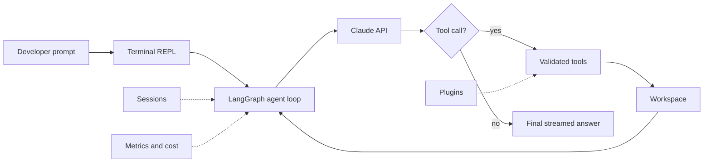

# DevMind Case Study

## Problem

Coding agents are useful only when they can inspect real projects, call tools safely, preserve state, expose costs, and recover from failures. DevMind was built as a readable terminal-native coding agent that shows the practical engineering behind tool-using AI systems.

## System Design

## Engineering Decisions

- Used LangGraph to make the agent loop explicit and inspectable.
- Built validated tools for reading, writing, editing, searching, listing, and shell execution.
- Added persistent sessions, autosave, compacted history, and named saves.
- Recorded token usage, estimated API cost, tool latency, retries, and task state.
- Added plugin support so new tools can be extended without rewriting the core loop.
- Focused heavily on offline tests so reliability does not depend on paid model calls.

## Validation Evidence

| Signal | Result |
| --- | --- |
| Test coverage | 156 offline tests |
| CI | GitHub Actions workflow present |
| Runtime | Terminal-native Python agent |
| Agent framework | LangGraph |
| Model provider | Anthropic Claude API |
| Reliability areas | tools, security guards, sessions, metrics, plugins, control flow |

## Why It Matters For AI Engineering

DevMind demonstrates core skills used in production agent systems: orchestration, tool execution, state persistence, observability, cost tracking, safety boundaries, plugin architecture, and testable control flow.

## Limitations

- DevMind is a portfolio-grade reference implementation, not a hosted SaaS coding product.
- Live operation requires an Anthropic API key.
- Shell execution should be sandboxed further before production use.
- The project does not claim SWE-bench results.

## Next Improvements

- Add a short demo GIF and screenshots.
- Add trace export for LangSmith or OpenTelemetry.
- Add Docker-based demo mode for easier review.
- Add a benchmark fixture for issue-to-patch coding tasks.
